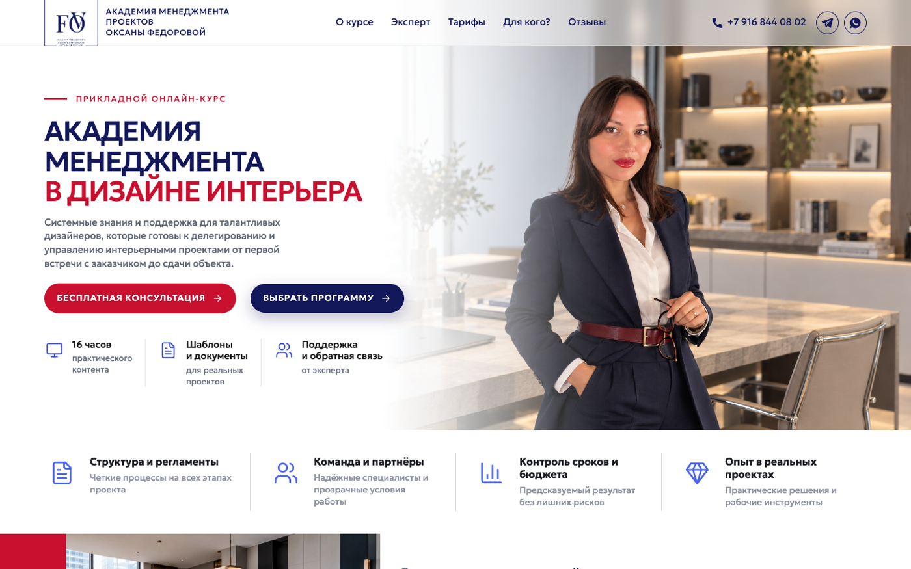
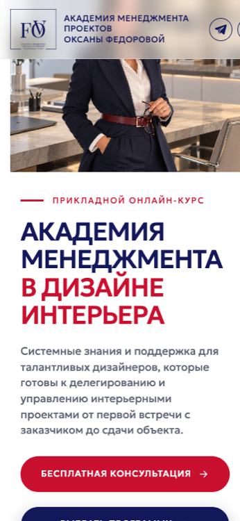

# practica_design

Landing page for an online course, "Academy of Management in Interior Design" by Oksana Fedorova. Built from the client's brief and revision notes. The page content itself is in Russian.

<p align="center">
  
  
</p>

## Features

- Responsive layout from 375 px up to wide screens, no horizontal scroll
- Sections: about the course, results, target audience, expert, curriculum, pricing, reviews
- Reviews open in a modal window
- Cookie consent banner
- Geologica font, inline SVG icons

## Project structure

```
practica_design/
├── index.html
├── assets/
│   ├── css/    # reset.css, styles.css
│   └── img/
└── screenshots/
```

The client's briefs (`.docx`) are in the repository root.

## Run locally

No build step. Open `index.html` in a browser, or start a local server:

```bash
python3 -m http.server 8000
```

## Tech stack

HTML · CSS · JavaScript

## Consultation form

Both consultation buttons open the native dialog in `index.html`. Styles are in
`assets/css/consult-form.css`; behavior is in `assets/js/consult-form.js`.

Telegram delivery is deferred. Set `data-endpoint` on `#consult-form` to the
server-side receiver URL once it is ready. The receiver accepts a JSON POST with
`name`, `phone`, `preferred_time`, `consent`, and `source`; return a successful HTTP
status and JSON `{ "success": true }` only after accepting the request. Keep bot
credentials on the server. Until connected, submission shows a Telegram contact
link and never claims the application was received.
